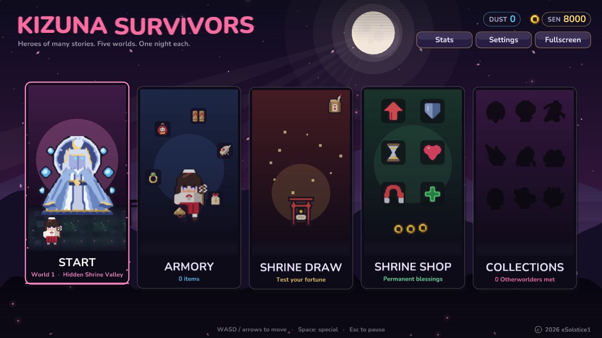
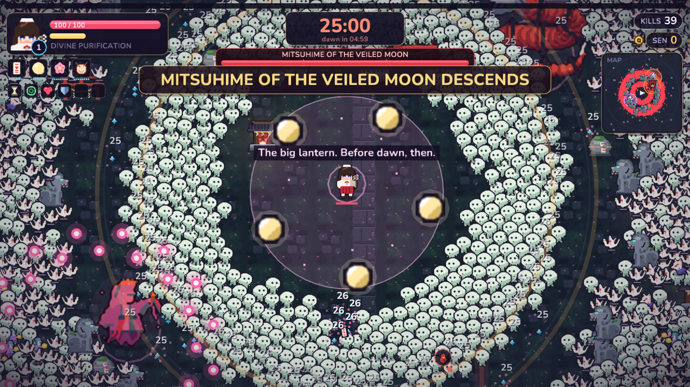
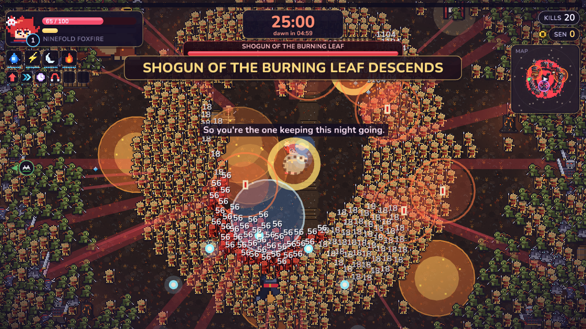
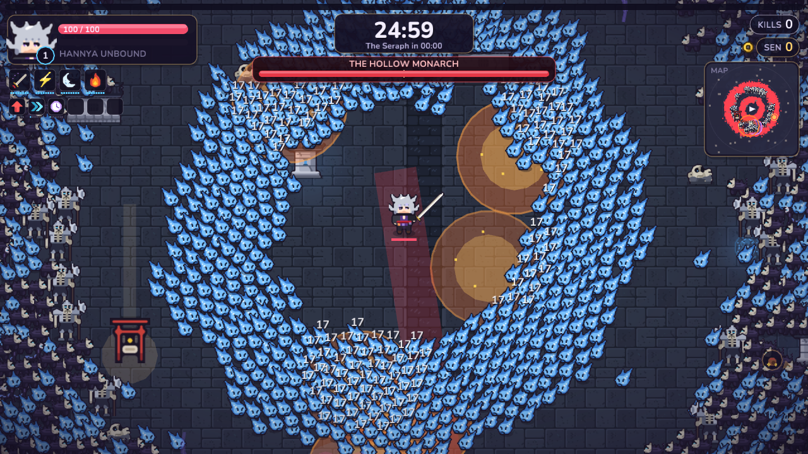
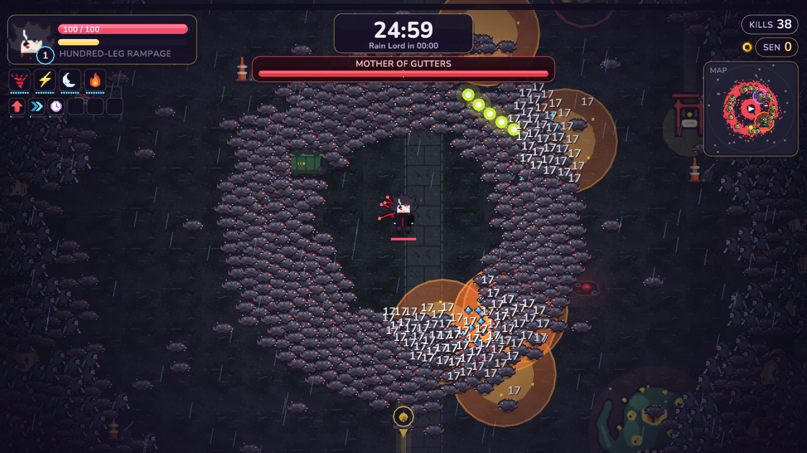
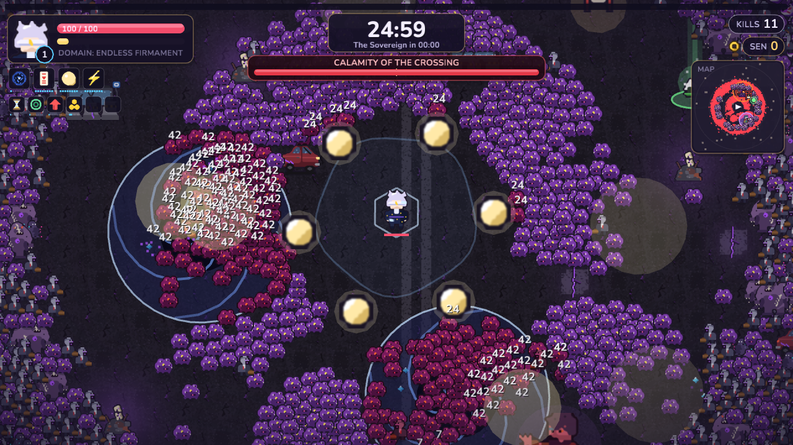
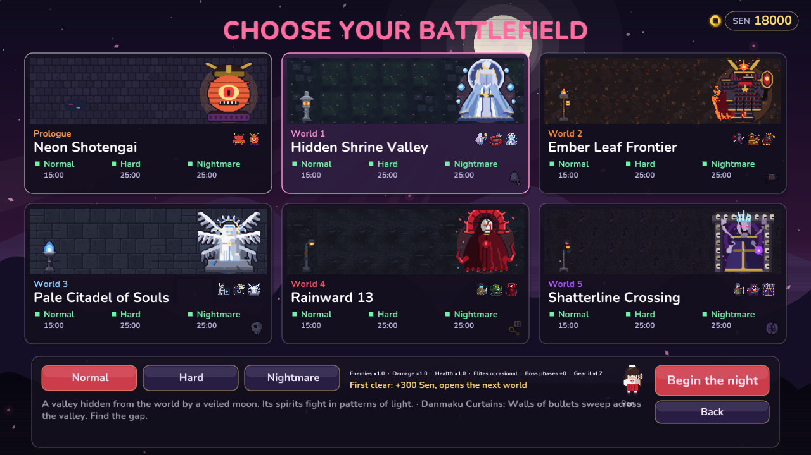
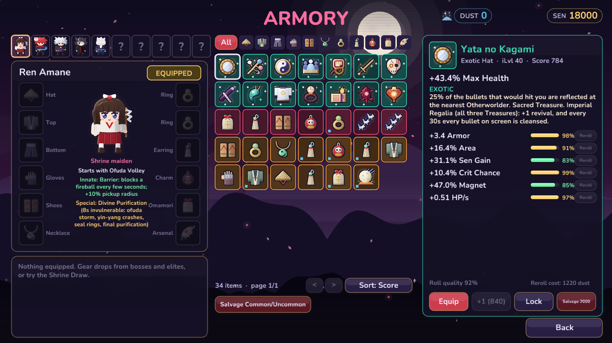
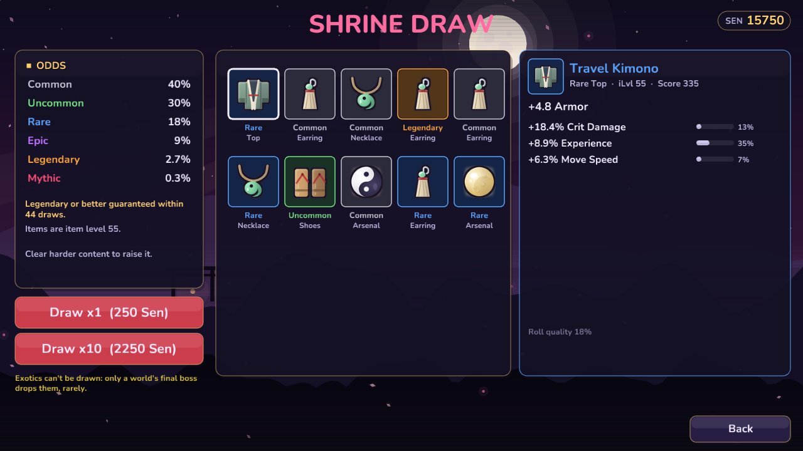

# Kizuna Survivors

**An anime-styled pixel-art survivors-like ("bullet heaven") for the browser.**
Heroes pulled out of many different stories fight their way through five original worlds,
one night at a time — thousands of Otherworlders on screen, big transforming specials, and an
endless chase for better gear.

### ▶ Play it now: **https://kizuna-survivors.vercel.app**

Runs in any modern browser on desktop and mobile (touch joystick, fullscreen, landscape). It is installable as an app and plays offline after the first visit.



---

## The game

You move; your weapons fire on their own. Collect spirit gems to level up, choose new weapons
and passives, open chests, accept a roadside shrine's blessing (it always comes with a price),
fill your special meter — and survive until the final boss rises.

Every weapon and passive has a rarity tier, Common to Unique, shown on its level-up card. Rarer
skills you don't own yet are offered less often. With all slots full, a card may offer to replace
one of your skills; the newcomer starts at half the old skill's level (minimum 1).

There are eight elements: Fire, Water, Electric, Earth, Wind, Ice, and the rare Light and Darkness.
They form a cycle: Water douses Fire, Fire melts Ice, Ice stills Wind, Wind erodes Earth, Earth
grounds Electric, Electric shocks Water. A hit on the element it beats deals x1.5; a hit on the one
that beats it deals x0.75. Every weapon, enemy and world has one, and hits sometimes trigger an
element effect: burn, soak, chain, stagger, knockback, slow, mark or drain.

| | |
|---|---|
|  |  |
| **Hidden Shrine Valley** — danmaku spirits, bullet curtains and Mitsuhime of the Veiled Moon | **Ember Leaf Frontier** — a ninja war, explosive tags and the Shogun of the Burning Leaf |
|  |  |
| **Pale Citadel of Souls** — spirit pressure, the Hollow Monarch and the Seraph of the Pale Throne | **Rainward 13** — a drowned ward in the rain, lightning and the Crimson Rain Lord |
|  |  |
| **Shatterline Crossing** — hostile domains and the Shatterline Sovereign | **Map select** — clears, best times, boss progress and relics per world |

### Heroes

Each hero is an original character with their own sprite, signature weapon, innate passive,
weapon pool and a transforming **special move**:

- **Ren Amane** — shrine maiden. Ofuda, yin-yang orbs, purification seals; *Divine Purification*. Affinity: Light.
- **Riku Kazamine** — fox-masked shinobi. Foxfire orbs, familiars, shuriken, clones; *Ninefold Foxfire*. Affinity: Fire.
- **Shun Yamikiri** — spirit ferryman with a great cleaver; *Hannya Unbound*. Affinity: Darkness.
- **Toya Hyakuashi** — cursed youth with crimson tendrils; *Hundred-Leg Rampage*. Affinity: Earth.
- **Kuon Hoshimi** — star-reading onmyōji who bends space; *Domain: Endless Firmament*. Affinity: Ice.

A hero deals +10% with skills of their own element, and their special move deals it too.

More heroes are on the way. Heroes unlock by clearing worlds with a specific hero.

### Campaign

- **Prologue + five worlds**, each with its own tiles, props, music, eleven Otherworlders (ten in the prologue), two Uncommons and a Leader among them,
  a sub-boss, a boss and a final boss, and a signature hazard (bullet curtains, explosive tags,
  spirit pressure, a blinding downpour, hostile domains).
- **65 Otherworlders in all, in rarity tiers**: Common, Uncommon, Elite, Leader, Sub-boss and
  Boss. Rarity shows as a coloured outline and a chevron, flag or boss-bar label. A Leader raises
  a banner: nearby enemies move and hit harder until it falls, and its crew scatters.
- **20 rounds a night**: every 4th round is a headline — an uncommon wave, the first elites, a
  Leader (rounds 12, 15, 18), the sub-boss, and the final boss in round 20 — while the bigger worlds add their own boss
  in round 18; the final boss must fall before dawn.
- **A dominant element per world** that most of its enemies carry: Shotengai Fire, Shrine Valley
  Earth, Ember Leaf Wind, Pale Citadel Ice, Rainward Water, Shatterline Electric.
- **Normal / Hard / Nightmare**, then **Ascension** (Nightmare+1, +2, … with no cap).
  Clearing Normal opens the next world; Nightmare clears earn a permanent **relic**.
- Bosses fight in phases; harder difficulties add phases.

### Gear — the endless chase



- **12 equipment slots** per hero: hat, top, bottom, gloves, shoes, necklace, two rings, earring,
  charm, omamori and the **Arsenal** — a bonus weapon that takes no weapon slot.
- **Common → Uncommon → Rare → Epic → Legendary → Mythic**: one to six rolled bonuses, each with a
  roll quality to chase. Legendary and Mythic items carry a unique effect; Legendary+ Arsenals grant
  attacks you can't get anywhere else (thunder drums, a fox procession, a sky dragon, moonfall …).
- **Every item has an element**: it adds damage of that element and resistance to enemies of it
  (shown by name on the item card). Resistance stacks across gear and a set, capped at 60%, and
  only applies to hits from enemies of that element. Legendary+ gear can roll Light or Darkness.
- **Exotics** — fourteen hand-made artefacts (a sovereign's severed finger, a hollow mask shard,
  the Three Sacred Treasures …) that drop only from a world's final boss, very rarely. Each has a
  fixed element.
- **Set** — the top tier. Each world has a six-piece set (the rings count only as a pair) that
  drops only from that world's mini-boss, boss and final boss, with a small chance per kill that
  grows with difficulty and Gear Find. Set pieces roll Exotic-quality bonuses, carry a unique, and
  take the world's element. Wearing pieces unlocks **2, 4, 5 and 6-piece bonuses**: the first two
  are the old world-set bonuses, the 5-piece adds +25% damage and +25% resistance of the set's
  element, and the 6-piece is a signature effect per set. Old set-tagged gear still counts toward
  the 2 and 4-piece bonuses only. Set pieces are never auto-salvaged on a full bag.
- **Spirit Dust** crafting (salvage, upgrade to +10, reroll a bonus) and a **Shrine Draw** with
  published odds and pity (the Draw never gives Set).



Also: a Shrine Shop of permanent upgrades, weapon **Awakenings**, a Collection, detailed Stats,
floor power-ups, a data-driven minimap, and a fully synthesised soundtrack.

## Controls

| | Keyboard / mouse | Touch |
|---|---|---|
| Move | WASD / arrow keys | Floating joystick (left side) |
| Special | Space | **SPECIAL** button |
| Choose a card / continue (level-up, shrine, chest) | ←/→ or A/D, Enter/Space (or 1–3); Esc walks away from a shrine or cancels a skill replacement | Tap a card |
| Pause | Esc | Pause button |
| Map | M / Tab | Tap the minimap |
| Damage numbers | N | — |

## Tech

- **Rust**, compiled to **WebAssembly**, rendered with [macroquad](https://github.com/not-fl3/macroquad).
- `crates/sim` — the engine-agnostic, deterministic game simulation (struct-of-arrays enemies,
  spatial grid, director, bosses, hazards, gear, save profile), with unit tests and a headless
  balance bot.
- `crates/client` — rendering, UI kit (virtual 1280×720 layout, high-DPI text), touch controls,
  audio and screens.
- **All art is generated as code**: pixel sprites are text `.px` files produced by the Python
  scripts in `tools/` and parsed at build time. **All audio is synthesised** at startup — no audio
  files ship.

### Build and run

```sh
# Native (desktop window)
cargo run -p client --release

# Tests
cargo test -p sim --release

# Balance bot (headless full runs)
BALANCE_SEEDS=20 BALANCE_STAGE=shrine_valley BALANCE_HERO=riku \
  cargo test --release -p sim balance -- --ignored --nocapture

# Browser build -> dist/ (static files)
./scripts/build-web.sh
cd dist && python3 -m http.server 8000
```

Requires a recent stable Rust toolchain with the `wasm32-unknown-unknown` target for the web build.

### Layout

```
crates/sim      game simulation (campaign, enemies, gear, world, meta/save)
crates/client   macroquad client (render, UI, menus, armory, audio, touch)
art/src         pixel art as text (.px), generated by tools/*.py
assets/fonts    Nunito (SIL Open Font License)
web/            index.html, JS plugins (save storage, fullscreen), PWA manifest, service worker and icons
scripts/        build scripts
```

## Credits

- Design and direction: **xSolstice1**.
- Font: [Nunito](https://fonts.google.com/specimen/Nunito) by Vernon Adams et al., SIL Open Font License 1.1.
- All characters, worlds and enemies are original creations, inspired by genres and folklore.

---

© 2026 xSolstice1. All rights reserved.
